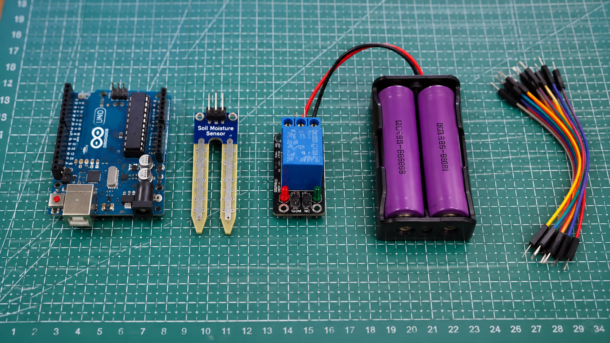
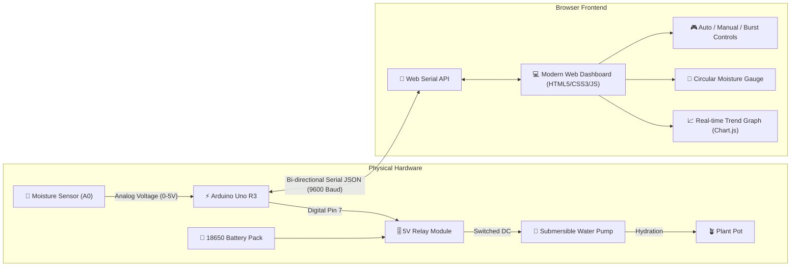

# 🌱 FloraPulse: Smart IoT Plant Watering System

[](https://www.arduino.cc/)
[](https://developer.mozilla.org/en-US/docs/Web/API/Web_Serial_API)
[](https://html.spec.whatwg.org/)
[](https://www.w3.org/TR/CSS/)
[](https://en.wikipedia.org/wiki/Internet_of_things)
[](LICENSE)

An intelligent, automated IoT plant irrigation and telemetry system. Built with an **Arduino Uno**, capacitive/resistive **soil moisture sensor**, **5V relay actuator**, **18650 battery power pack**, and a modern **Web Serial dashboard** for real-time monitoring and manual/automated pump control directly from the browser.

---

## 📸 Hardware Setup



---

## 🎥 YouTube Video Demonstration

Watch the system in action (hardware demonstration, automatic threshold detection, and water pump activation):

[](https://www.youtube.com/watch?v=YOUR_VIDEO_ID_HERE)

> 💡 *Note: Replace `https://www.youtube.com/watch?v=YOUR_VIDEO_ID_HERE` with your actual YouTube video link.*

---

## 📌 Project Overview & Evolution

Initially prototyped using **Blynk IoT**, this upgraded edition transitions the project to an **independent, zero-cloud-dependency Web Dashboard** powered by the **W3C Web Serial API**.

### Why Shift from Blynk to Web Dashboard?
1. **Zero Recurring Cloud/Subscription Costs**: No Blynk token expirations, device limits, or server downtime.
2. **Direct Browser-to-Hardware Control**: Google Chrome and Microsoft Edge communicate with the Arduino Uno over USB Serial with millisecond latency.
3. **Portfolio Showcase Ready**: Can be hosted completely free on **GitHub Pages**, featuring an interactive **Simulation Mode** so recruiters can test the UI in real time without needing physical hardware.
4. **Rich Telemetry Visualizations**: Real-time circular gauges, live trend graphs via Chart.js, and multi-component health telemetry.

---

## 🧰 Hardware Components

The project is built around 5 core hardware modules:

| # | Component | Model / Spec | Purpose in System |
|---|-----------|--------------|-------------------|
| **1** | **Microcontroller** | Arduino Uno R3 (ATmega328P) | Core processing unit; reads analog sensor data, executes control logic, and communicates over Serial (9600 baud). |
| **2** | **Soil Moisture Sensor** | Capacitive / Resistive Soil Probe (AO/DO) | Measures real-time volumetric water content in soil; outputs analog voltage to pin `A0`. |
| **3** | **Relay Module** | 1-Channel 5V Relay (Active-LOW) | Optoisolated electronic switch isolating Arduino 5V logic from the pump's higher motor currents. |
| **4** | **Battery Power Pack** | Dual 18650 Li-ion Cells (7.4V / 3.7V) | Independent DC power supply for the submersible pump to eliminate inductive noise and voltage drops on the Arduino. |
| **5** | **Connecting Wires & Pump** | 3-6V DC Mini Submersible Pump + Silicone Tubing + Jumpers | Delivers water from reservoir to plant pot; jumper wires distribute power and telemetry. |

---

## ⚡ Circuit Pinout & Wiring Connections

```
                             +-------------------+
                             |    Arduino Uno    |
                             |                   |
  Soil Sensor (AO) --------> | A0                |
  Soil Sensor (VCC) <------- | 5V                |
  Soil Sensor (GND) <------- | GND               |
                             |                   |
  Relay Module (IN) <------- | Pin 7             |
  Relay Module (VCC) <------ | 5V                |
  Relay Module (GND) <------ | GND               |
                             +-------------------+

       +------------------------------------------------------+
       |                  Relay & Pump Loop                   |
       |                                                      |
       |  [Battery (+)] -----> [Relay COM]                    |
       |                       [Relay NO] ----> [Pump (+)]    |
       |  [Battery (-)] ----------------------> [Pump (-)]    |
       +------------------------------------------------------+
```

### Pin Assignment Table

| Arduino Uno Pin | Connected Device | Device Pin | Description |
|-----------------|------------------|------------|-------------|
| **A0** | Soil Moisture Sensor | AO (Analog Out) | Analog signal output (0 - 1023) |
| **5V** | Soil Moisture Sensor | VCC | 5V DC supply |
| **GND** | Soil Moisture Sensor | GND | Common Ground |
| **Pin 7** | Relay Module | IN (Signal) | Digital trigger (Active LOW: LOW = ON, HIGH = OFF) |
| **5V** | Relay Module | VCC | 5V Coil Power |
| **GND** | Relay Module | GND | Common Ground |
| **USB Type-B** | PC / Laptop | USB Port | Serial communication & Arduino logic power |

---

## 🏗️ System Architecture



---

## 💻 Web Dashboard Features

The web frontend located in [`frontend/`](frontend/) is built with modern, responsive vanilla web technologies:

- **🔌 One-Click Web Serial Connection**: Connect directly to Arduino COM port in Google Chrome or Microsoft Edge without third-party drivers.
- **🎯 Dynamic Circular Moisture Gauge**: Color-shifting SVG gauge (Red = Dry, Emerald = Optimal, Blue = Saturated).
- **🕹️ Actuator Control Hub**:
  - **Auto Mode**: System automatically irrigates in 3-second controlled bursts when moisture dips below threshold, followed by a soak delay to avoid overwatering.
  - **Manual Override**: Trigger a 3-second quick burst or toggle continuous flow.
  - **Dynamic Threshold Slider**: Real-time slider (10% - 80%) instantly synchronizes threshold with the Arduino.
  - **Emergency Stop Button**: Instant failsafe cutoff.
- **📊 Live Analytical Charting**: Rolling window graph tracking soil moisture history against the trigger threshold.
- **✨ Built-in Interactive Simulation Mode**: Click "Demo Simulation" toggle to showcase all features, real-time drying, and automatic watering bursts on **GitHub Pages** without requiring hardware!

---

## 🚀 Quick Start Guide

### 1. Upload Arduino Firmware
1. Open the [Arduino IDE](https://www.arduino.cc/en/software).
2. Connect your Arduino Uno to your PC via USB cable.
3. Open [`arduino/smart_plant_watering.ino`](arduino/smart_plant_watering.ino).
4. Select **Tools > Board > Arduino Uno** and pick your active **COM Port**.
5. Click **Upload**.
6. Close the Arduino IDE Serial Monitor (this ensures the COM port is free for the web browser).

### 2. Launch the Web Dashboard
1. Open [`frontend/index.html`](frontend/index.html) in **Google Chrome**, **Microsoft Edge**, or **Opera**.
2. Click **"Connect Arduino"** in the top navigation bar.
3. Select your Arduino's serial port from the browser prompt and click **Connect**.
4. The dashboard will instantly light up with real-time moisture readings!

### 3. (Optional) Run Python WebSocket Bridge
If you wish to run the dashboard across local network devices (tablets/phones) or on a headless Raspberry Pi:
```bash
cd server
pip install -r requirements.txt
python bridge.py COM3   # Replace with your Arduino COM port
```

---

## 🧪 Calibration Guide

Soil moisture sensor analog output varies with soil salinity, mineral content, and ambient temperature:
1. **Air Value (Completely Dry)**: Hold the probe in dry air and note the `Raw ADC` value on the dashboard (typically `~700 - 850`).
2. **Water Value (Fully Submerged)**: Dip the probe up to the safe line in a cup of water and note the `Raw ADC` value (typically `~250 - 350`).
3. Update `airValue` and `waterValue` constants in [`arduino/smart_plant_watering.ino`](arduino/smart_plant_watering.ino#L26-L27) for pinpoint percentage precision.

---


## 📂 Repository Structure

```
SmartPlantWateringSystem/
├── assets/
│   └── project_hardware.jpg         # Real photo of the physical build
├── arduino/
│   └── smart_plant_watering.ino     # Complete Arduino Uno C++ firmware
├── frontend/
│   ├── index.html                   # Modern IoT web dashboard
│   ├── style.css                    # Glassmorphism dark/emerald UI styling
│   └── app.js                       # Web Serial API & Chart.js logic
├── server/
│   ├── bridge.py                    # Optional Serial-to-WebSocket bridge
│   └── requirements.txt             # Python bridge dependencies
├── .gitignore                       # Git ignore configuration
└── README.md                        # Portfolio documentation
```

---


## 📄 License

This project is licensed under the [MIT License](LICENSE) - feel free to use and adapt it for academic and personal projects!

